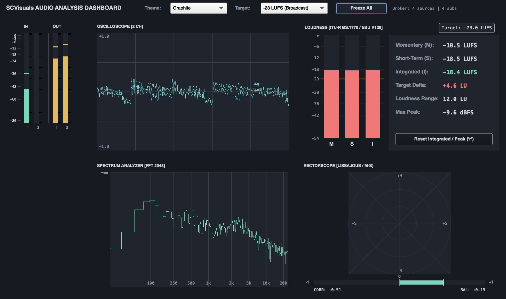
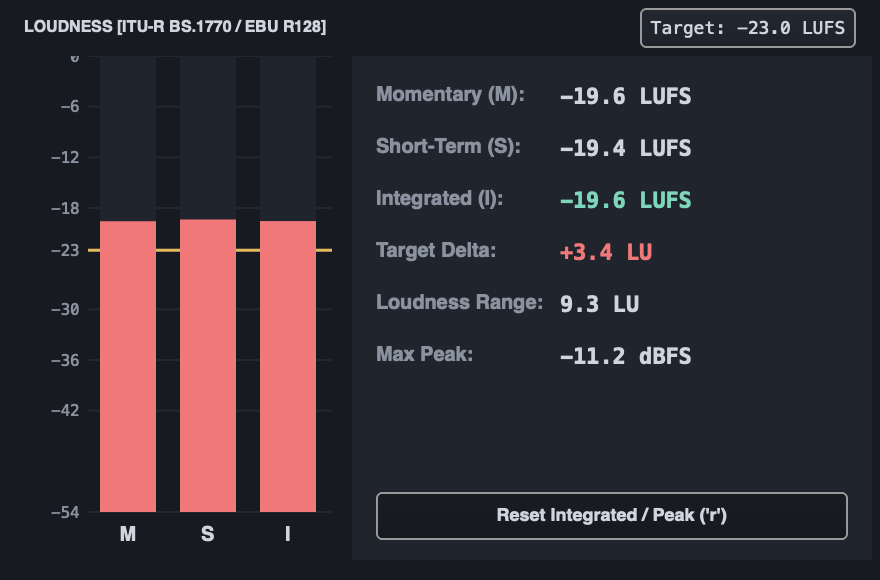
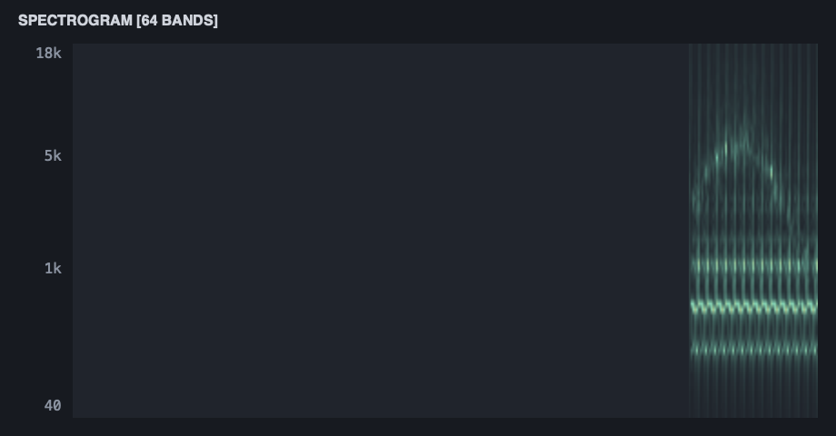
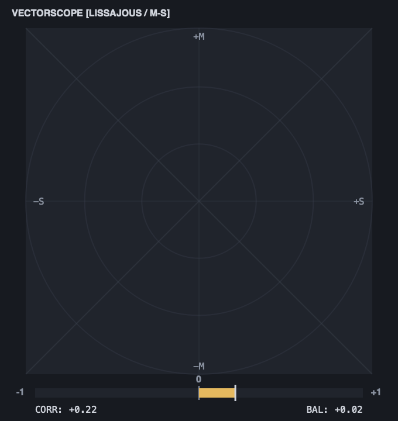
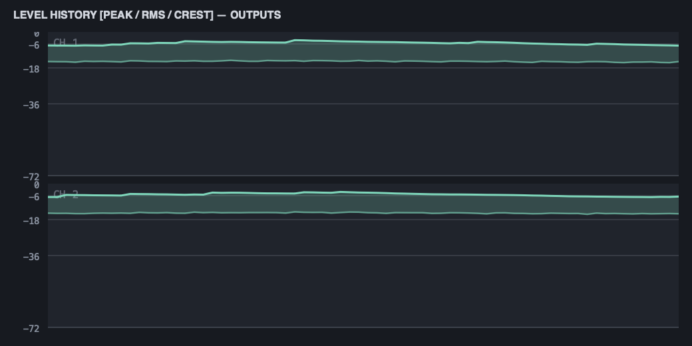

# SCVisuals

[](https://supercollider.github.io/)
[](LICENSE)
[](tests/)
[](classes/)

A cohesive, configurable, **lightweight** family of real-time audio-analysis visualizers for SuperCollider.

`SCVisuals` prioritizes audio-thread safety (`scsynth`), predictable resource lifecycle, centralized analysis sharing, and elegant modern aesthetics—with zero mandatory C++ compilation, zero external binary dependencies, and zero modifications to stock SuperCollider files.

---

## Visualizer Lineup

| Instrument | Description | Backend Transport | Status |
|---|---|---|---|
| **`SCVMeter`** | Compact vertical server meter (inputs/outputs, dB ruler, peak/RMS, peak-hold) | `SendPeakRMS` via `SCVLevelsSource` | **Production (v0.1.0)** |
| **`SCVScope`** | Themed oscilloscope with transparent grid overlays, tracks, overlay, and X/Y styles | `ScopeView` / `ScopeOut2` shared memory | **Production (v0.1.0)** |
| **`SCVSpectrum`** | Themed FFT spectrum analyzer (linear & logarithmic frequency markers, dB scale) | FreqScope FFT pipeline | **Production (v0.1.0)** |
| **`SCVSpectrogram`**| 2D scrolling time–frequency spectrogram with circular ring-buffer blit | 64-band logarithmic `SendReply.kr` | **Production (v0.1.0)** |
| **`SCVWaterfall`** | 2.5D isometric stacked-line spectral history with depth-cued color shading | Shared `SCVSpectrumSource` | **Production (v0.1.0)** |
| **`SCVHistory`** | Rolling peak, RMS, and shaded crest factor timeline history chart | Shared `SCVLevelsSource` | **Production (v0.1.0)** |
| **`SCVLoudness`** | ITU-R BS.1770-4 / EBU R128 loudness meter (M, S, I, LRA, -23 / -14 LUFS targets) | Two-stage K-weighting biquads | **Production (v0.1.0)** |
| **`SCVVectorscope`**| Stereo Lissajous X/Y display with Mid/Side polar graticule and phase correlation | `ScopeOut2` + Correlation UGen | **Production (v0.1.0)** |
| **`SCVDashboard`** | Unified 5-panel command center with global theme propagation and master freeze | `SCVMeasurementBroker` | **Production (v0.1.0)** |

---

## Screenshots

| Unified Dashboard | ITU-R BS.1770 Loudness Meter |
| :---: | :---: |
|  |  |

| 2.5D Waterfall Spectrum | 2D Scrolling Spectrogram |
| :---: | :---: |
|  |  |

| Stereo Vectorscope & Phase Correlation | Peak, RMS & Crest Factor History |
| :---: | :---: |
|  |  |

---

## Quick Start

```supercollider
// 1. Boot Server
s.boot;

// 2. Play Test Signal
x = { Saw.ar([110, 110.5]) * 0.25 }.play;

// 3. Open Any Instrument
SCVisuals.dashboard(s);                                       // Complete 5-panel dashboard
SCVisuals.meter(s);                                           // Vertical Server Meter
SCVisuals.scope(s, 0, 2, theme: \ice);                        // Themed Oscilloscope
SCVisuals.spectrum(s, 0, 2048, theme: \amber);                // Logarithmic FFT Spectrum
SCVisuals.spectrogram(s, 0, 64, theme: \graphite);            // Scrolling Spectrogram
SCVisuals.waterfall(s, 0, 64, theme: \phosphor);              // 2.5D Waterfall
SCVisuals.history(s, \outputs, 0, 2);                         // Level & Crest Factor History
SCVisuals.loudness(s, \outputs, 0, 2, targetLUFS: -23.0);     // EBU R128 Loudness Meter
SCVisuals.vectorscope(s, 0);                                  // Lissajous & Phase Correlation
```

---

## Architecture: Centralized Measurement Broker

Multiple visualizers monitoring the same server bus automatically **share a single analysis Synth**:

```text
               ┌───────────────────────────────┐
               │    scsynth Audio Bus          │
               └───────────────┬───────────────┘
                               │
               ┌───────────────▼───────────────┐
               │     SCVMeasurementBroker      │
               └───────┬───────────────┬───────┘
                       │               │
        ┌──────────────▼──────┐ ┌──────▼───────────────┐
        │  SCVSpectrumSource  │ │   SCVLoudnessSource  │
        └──────┬──────────────┘ └──────┬───────────────┘
               │                       │
      ┌────────┴────────┐              │
┌─────▼───────┐  ┌──────▼──────┐ ┌─────▼─────────┐
│ Spectrogram │  │  Waterfall  │ │ LoudnessView  │
└─────────────┘  └─────────────┘ └───────────────┘
```

- **Zero Duplicate Synths:** Opening Spectrogram, Waterfall, and Spectrum together never creates redundant FFT nodes.
- **Reference Counting:** Sources start on first subscriber and automatically free when all subscribers close.
- **Fail-Safe Lifecycle:** Clean recovery on `CmdPeriod` and `ServerQuit`.

---

## Themes & Ergonomics

`SCVisuals` provides six immutable, scientifically calibrated palettes:

1. **Graphite** (Default): Sleek dark studio aesthetic (`#171A20`).
2. **Phosphor**: Vintage green monochrome CRT glow (`#09140F`).
3. **Ice**: Crisp Nordic blue-cyan technical readout (`#101A2A`).
4. **Amber**: Warm vintage mastering console (`#1A1712`).
5. **Paper**: High-contrast light mode for daytime work and publication printing (`#F1EDE2`).
6. **Monochrome**: Minimalist grayscale (`#111111`).

All instruments support three density modes (`\micro`, `\compact`, `\extended`) and dynamic theme switching via `.theme = \ice`.

---

## Truth in Labeling

| Measurement | Standard / Definition | Window / Ballistics | Range / Units |
|---|---|---|---|
| **Peak** | Unwindowed absolute sample maximum | Instantaneous ($O(1)$) | $-\infty$ to $0.0$ dBFS |
| **RMS** | Root mean square energy | 100 ms ($10 \times \text{blockSize}$) | $-\infty$ to $0.0$ dBFS |
| **Momentary Loudness (M)** | ITU-R BS.1770-4 K-weighting | 400 ms sliding rectangular | $-\infty$ to $0.0$ LUFS |
| **Short-Term Loudness (S)** | ITU-R BS.1770-4 K-weighting | 3.0 s sliding rectangular | $-\infty$ to $0.0$ LUFS |
| **Integrated Loudness (I)**| ITU-R BS.1770 / EBU R128 | Dual-gated ($-70$ LUFS abs / $-10$ LU rel) | Target: $-23$ or $-14$ LUFS |
| **Loudness Range (LRA)** | EBU Tech 3342 | 95th minus 10th percentile of $S$ blocks | $0.0$ to $+30.0$ LU |
| **Phase Correlation** | Normalized cross-correlation | 250 ms integration | $-1.0$ to $+1.0$ |

---

## Installation & Testing

```supercollider
// Install Quark
Quarks.install("~/Desktop/SC New Visulations servers/SCVisuals");

// Recompile Class Library
thisProcess.recompile;

// Run Master Test Suite (218 Assertions across 9 Suites)
"tests/run_all_tests.scd".loadRelative;
```

---

## License

GNU General Public License v3.0 or later ([LICENSE](LICENSE)).
