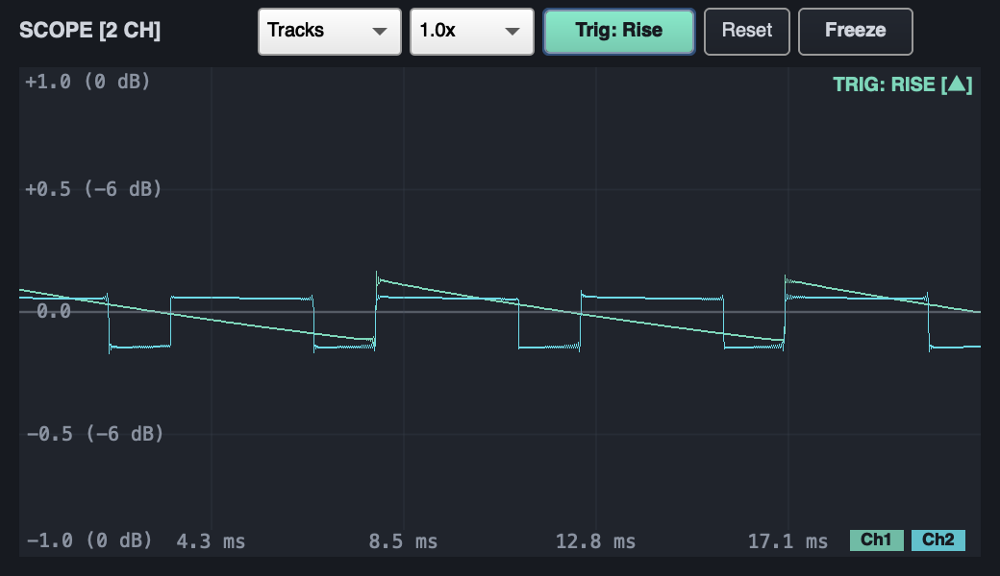
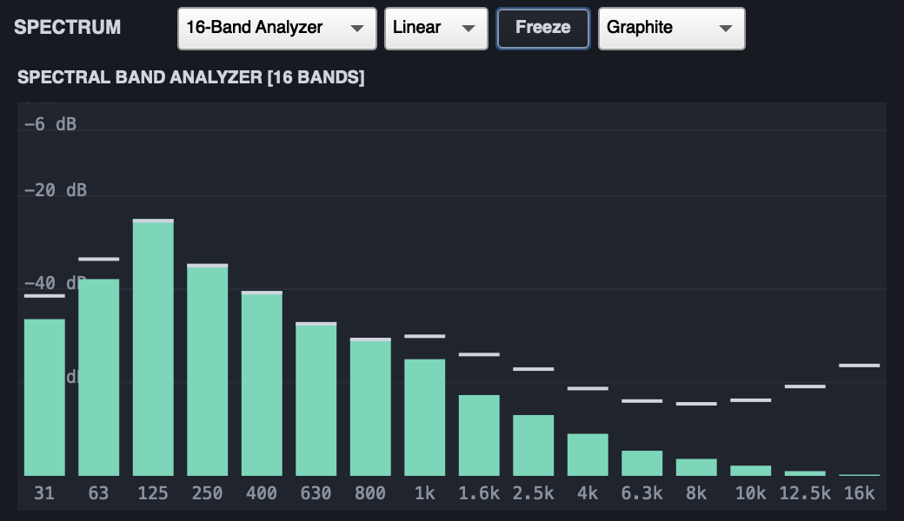
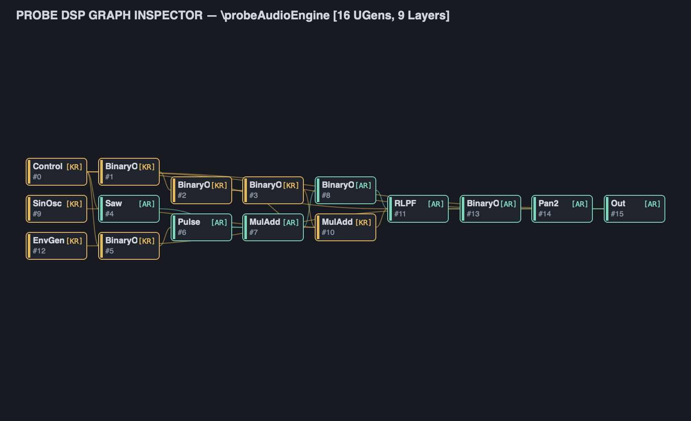
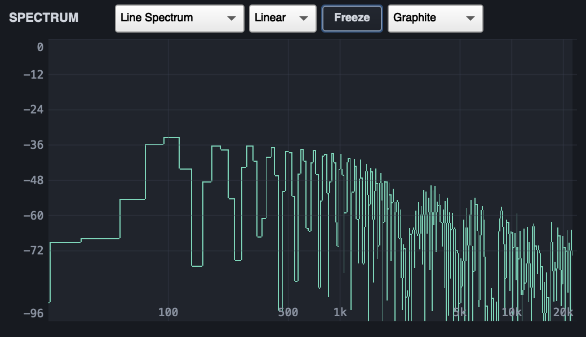
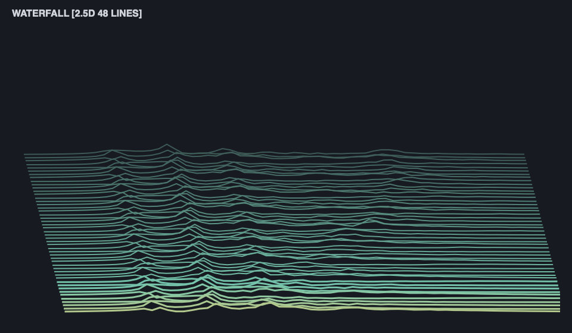

# Probe

[](https://supercollider.github.io/)
[](LICENSE)
[](tests/)
[](docs/decisions/ADR-001-Dual-Tier-Namespace-and-Ergonomics.md)

A cohesive, laboratory-grade, **lightweight** family of real-time audio analysis, visualization, and signal instrumentation tools for SuperCollider.

`Probe` prioritizes audio-thread safety (`scsynth`), predictable resource lifecycle, centralized analysis sharing, and pristine IDE autocomplete ergonomics—with zero mandatory C++ compilation, zero external binary dependencies, and zero modifications to stock SuperCollider files.

---

## Clean IDE Autocomplete: Dual-Tier Architecture

To prevent polluting the SuperCollider IDE autocomplete search space, Probe implements a strict **Dual-Tier Hierarchy** ([ADR-001](docs/decisions/ADR-001-Dual-Tier-Namespace-and-Ergonomics.md)):

- **Tier 1 (`Probe*`)**: Exactly **14 public, high-level classes** appear when typing `Probe` in the IDE.
- **Tier 2 (`PB_*`)**: All internal plumbing, telemetry sources, and embeddable composite view classes use the private `PB_*` prefix (`PB_Broker`, `PB_LevelsSource`, `PB_SpectrumSource`, `PB_ScopeView`, etc.).
- **Embeddable View Factory**: Every visualizer exposes an embeddable GUI constructor via `Probe*.view(parent, bounds, ...)` so user code never needs to reference internal `PB_*View` classes.

---

## Visualizer Lineup

| Instrument | Description | Embeddable View Factory | Backend Transport |
|---|---|---|---|
| **`s.meterPb`** / `Probe.meter` | Compact vertical server meter (inputs/outputs, dB ruler, peak/RMS, peak-hold) | `ProbeMeter.view(parent, bounds)` | `SendPeakRMS` via `PB_LevelsSource` |
| **`s.scopePb`** / `Probe.scope` | Oscilloscope with calibrated ms/dBFS axes, stationary trigger edge lock (`\rising`, `\falling`), tracks/overlay/XY | `ProbeScope.view(parent, bounds)` | `ScopeView` / `ScopeOut2` + DSP circular latch buffer |
| **`s.freqscopePb`** / `Probe.spectrum` | Unified FFT spectrum analyzer with 3 modes (Line, 16-Band Analyzer, Spectrogram) and interactive cursor | `ProbeSpectrum.view(parent, bounds)` | Precision FreqScope FFT pipeline |
| **`s.spectralDashboardPb`** / `Probe.spectralDashboard` | 4-preset command center (Overview, Pitch, Time-Frequency, Compare) with 16-band analyzer, chroma, and descriptors | `ProbeSpectralDashboard.view(parent, bounds)` | `PB_SpectralSource` & `PB_Broker` |
| **`s.bandAnalyzerPb`** / `Probe.bandAnalyzer` | 16-band ISO 1/3-octave band analyzer with peak indicators and RMS bars | `ProbeBandAnalyzer.view(parent, bounds)` | `PB_SpectralSource` filterbank |
| **`s.inspectorPb`** / `Probe.inspect` | Static topological signal-flow Directed Acyclic Graph (DAG) inspector with rate coloring and bezier routing | `ProbeInspector.view(parent, bounds)` | Static SCLang DAG compilation (`PB_GraphView`) |
| **`.trace`** | Transparent runtime in-graph signal tracing for audio rate (Scope) and control rate (20 Hz Timeline HUD) | Integrated HUD | Dual transport: `ScopeOut2` / `SendReply.kr` (`PB_Trace`) |
| **`s.spectrogramPb`** / `Probe.spectrogram` | 2D scrolling time–frequency spectrogram with circular ring-buffer blit | `ProbeSpectrogram.view(parent, bounds)` | 64-band logarithmic `SendReply.kr` |
| **`s.waterfallPb`** / `Probe.waterfall` | 2.5D isometric stacked-line spectral history with depth-cued color shading | `ProbeWaterfall.view(parent, bounds)` | Shared `PB_SpectrumSource` |
| **`s.historyPb`** / `Probe.history` | Rolling peak, RMS, and shaded crest factor timeline history chart | `ProbeHistory.view(parent, bounds)` | Shared `PB_LevelsSource` |
| **`s.loudnessPb`** / `Probe.loudness` | ITU-R BS.1770-4 / EBU R128 loudness meter (M, S, I, LRA, -23 / -14 LUFS targets) | `ProbeLoudness.view(parent, bounds)` | Two-stage K-weighting biquads (`PB_LoudnessSource`) |
| **`s.vectorscopePb`** / `Probe.vectorscope` | Stereo Lissajous X/Y display with Mid/Side polar graticule and phase correlation | `ProbeVectorscope.view(parent, bounds)` | `ScopeOut2` + Correlation UGen |
| **`s.dashboardPb`** / `Probe.dashboard` | Unified 5-panel command center with global theme propagation and master freeze | `ProbeDashboard.view(parent, bounds)` | `PB_Broker` |

> [!NOTE]
> For backwards compatibility, legacy shorthand methods (`s.meter2`, `s.scope2`, `s.freqscope2`, etc.) and the `SCVisuals` facade remain fully functional as aliases forwarding to the new `*Pb` methods.

---

## Visual Gallery

| Oscilloscope Trigger Stabilization | 16-Band Octave Analyzer |
| :---: | :---: |
|  |  |

| Static DSP Graph Inspector | Advanced Spectral Dashboard |
| :---: | :---: |
|  |  |

| Precision Line FFT Spectrum | 2.5D Waterfall Spectrum |
| :---: | :---: |
|  |  |

---

## Quick Start

### 1. Server Ergonomics (`*Pb`)

```supercollider
// Boot default server
s.boot;

// Play test signal
x = { Saw.ar([110, 110.5]) * 0.25 }.play;

// Open instruments via Server Shortcuts
s.meterPb;               // Vertical Server Meter
s.scopePb;               // Oscilloscope with Trigger Stabilization
s.freqscopePb;           // 3-Mode Spectrum Analyzer
s.spectralDashboardPb;   // 4-Preset Spectral Dashboard
s.dashboardPb;           // 5-Panel Command Center
s.loudnessPb;            // EBU R128 Loudness Meter

// Transparent In-Graph Signal Tracing (.trace)
y = {
    var lfo = SinOsc.kr(1.5).range(200, 2000).trace(\cutoff); // 20 Hz scrolling HUD
    var sig = Saw.ar(110).trace(\rawOsc);                     // Sample-accurate scope
    RLPF.ar(sig, lfo, 0.2);
}.play;

// Static DSP Graph Inspection
s.inspectPb(y.def);
```

### 2. Embeddable GUI Views (`Probe*.view`)

Embed visualizers directly into custom GUI layouts without importing internal plumbing classes:

```supercollider
w = Window("Custom Mastering Layout", Rect(100, 100, 800, 400)).front;
w.layout = HLayout(
    ProbeMeter.view(w, numIns: 0, numOuts: 2),
    ProbeScope.view(w, busIndex: 0, numChannels: 2),
    ProbeSpectrum.view(w, busIndex: 0)
);
```

---

## Architecture: Centralized Measurement Broker

Multiple visualizers monitoring the same server bus automatically **share a single analysis Synth**:

```text
               ┌───────────────────────────────┐
               │    scsynth Audio Bus          │
               └───────────────┬───────────────┘
                               │
               ┌───────────────▼───────────────┐
               │           PB_Broker           │
               └───────┬───────────────┬───────┘
                       │               │
        ┌──────────────▼──────┐ ┌──────▼───────────────┐
        │  PB_SpectrumSource  │ │   PB_LoudnessSource  │
        └──────┬──────────────┘ └──────┬───────────────┘
               │                       │
      ┌────────┴────────┐              │
┌─────▼─────────┐ ┌─────▼─────────┐ ┌──▼───────────────┐
│ PB_Spectrogram│ │ PB_Waterfall  │ │ PB_LoudnessView  │
└───────────────┘ └───────────────┘ └──────────────────┘
```

- **Zero Duplicate Synths:** Opening Spectrogram, Waterfall, and Spectrum together never creates redundant FFT nodes.
- **Reference Counting:** Sources start on first subscriber and automatically free when all subscribers close.
- **Fail-Safe Lifecycle:** Clean recovery on `CmdPeriod` and `ServerQuit`.

---

## Themes & Ergonomics

Probe provides seven immutable, scientifically calibrated palettes:

1. **Graphite** (Default): Sleek dark studio aesthetic (`#171A20`).
2. **Phosphor**: Vintage green monochrome CRT glow (`#09140F`).
3. **Ice**: Crisp Nordic blue-cyan technical readout (`#101A2A`).
4. **Amber**: Warm vintage mastering console (`#1A1712`).
5. **Paper**: High-contrast light mode for daytime work and publication printing (`#F1EDE2`).
6. **Monochrome**: Minimalist grayscale (`#111111`).
7. **Pure Data**: Stark black-and-white minimalist low-res aesthetic with monospace typography (`#FFFFFF` canvas with solid `#000000` signal traces and controls).

All instruments support dynamic font scaling (`1.0` to `2.0`, default `1.25`) and dynamic theme switching via `.theme = \puredata`.

---

## Truth in Labeling

| Measurement | Standard / Definition | Window / Ballistics | Range / Units |
|---|---|---|---|
| **Peak** | Unwindowed absolute sample maximum | Instantaneous ($O(1)$) | $-\infty$ to $0.0$ dBFS |
| **RMS** | Root mean square energy | 100 ms ($10 \times \text{blockSize}$) | $-\infty$ to $0.0$ dBFS |
| **Momentary Loudness (M)** | ITU-R BS.1770-4 K-weighting | 400 ms sliding rectangular | $-\infty$ to $0.0$ LUFS |
| **Short-Term Loudness (S)** | ITU-R BS.1770-4 K-weighting | 3.0 s sliding rectangular | $-\infty$ to $0.0$ LUFS |
| **Integrated Loudness (I)**| ITU-R BS.1770 / EBU R128 | Dual-gated ($-70$ LUFS abs / $-10$ LU rel) | Target: $-23$ or $-14$ LUFS |
| **Loudness Range (LRA)** | EBU Tech 3342 | 95th minus 10th percentile of $S$ blocks | $0.0$ to $+30.0$ LU |
| **Spectral Centroid** | Frequency-weighted spectral mean | Magnitude-weighted FFT frame | Hz / kHz |
| **Phase Correlation** | Normalized cross-correlation | 250 ms integration | $-1.0$ to $+1.0$ |

---

## Installation & Testing

```supercollider
// Install Quark
Quarks.install("~/Desktop/SC New Visulations servers/SCVisuals");

// Recompile Class Library
thisProcess.recompile;

// Run Master Test Suite (14 Suites Passing Cleanly)
"tests/run_all_tests.scd".loadRelative;

// Verify System-Wide Health (101 Assertions Passing)
"scripts/verify_system_install.scd".loadRelative;
```

---

## Documentation

Full class documentation is integrated directly into the SuperCollider Help browser (`Cmd+D`):

```supercollider
Probe.help;
ProbeScope.help;
ProbeSpectralDashboard.help;
ProbeInspector.help;
```

---

## License

GNU General Public License v3.0 or later ([LICENSE](LICENSE)).
