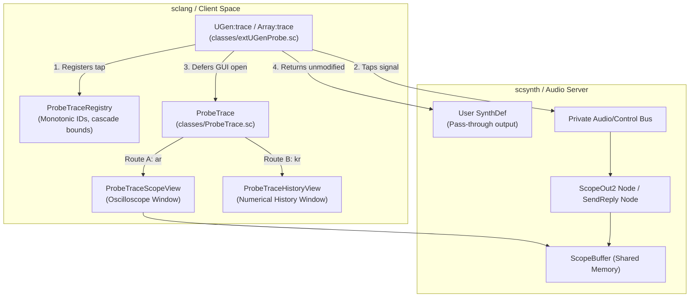

# Probe Phase II — Internal Signal `.trace` Architecture & Transport Specification

**Document:** `docs/phase2/trace-architecture.md`  
**Date:** 2026-10-17  
**Stage:** Phase II — P2 (Signal Tracing Architecture & Implementation)  
**Authors:** Antigravity / Google DeepMind Agentic Pair  

---

## 1. Objective & Desired Ergonomics

Probe `.trace` provides zero-boilerplate, transparent runtime visualization of internal synthesis signals without modifying signal chains, altering sound character, or adding cumbersome monitoring boilerplate.

### Target API Syntax
```supercollider
// 1. Audio-rate waveform trace (ScopeOut2 hardware waveform display)
{ SinOsc.ar(440, 0, 0.1).trace }.play;

// 2. Control-rate numerical history trace (SendReply.kr 20Hz timeline)
{
    var cutoff = LFNoise1.kr(2).exprange(150, 4500).trace(\cutoff);
    RLPF.ar(Saw.ar(110, 0.05), cutoff, 0.2);
}.play;

// 3. Multiple named taps coexisting cleanly
{
    var input = Saw.ar(110, 0.05).trace(\beforeFilter);
    RLPF.ar(input, 1200, 0.2).trace(\afterFilter);
}.play;

// 4. Multichannel and explicit modes
{ Saw.ar([110, 220], 0.05).trace(\stereoSaw, mode: \scope) }.play;
{ WhiteNoise.ar(0.1).trace(\noiseSpectrum, mode: \spectrum) }.play;
```

---

## 2. Invariants & Semantics

1. **Pass-Through Transparency:**
   - `.trace` always returns `this` within `SynthDef.wrap`.
   - The original signal expression is passed to downstream UGens without any modification (0 dB gain change, 0 phase shift, 0 DC offset).
2. **Rate Distinction & Default Instruments:**
   - **Audio Rate (`\audio`):** Defaults to `\scope` (oscilloscope waveform). An audio signal oscillating at 440 Hz or 10 kHz cannot be accurately represented by a 20 Hz numerical stream; it requires sample-accurate waveform buffers.
   - **Control Rate (`\control`):** Defaults to `\history` (rolling numerical graph showing min, max, instantaneous value, and time progression).
3. **Decoupled Client/Server Lifecycle:**
   - `.trace` executes at SynthDef compile time on sclang.
   - GUI launching is cleanly deferred via `AppClock` to pair with live synth execution.
   - If a SynthDef is compiled offline or headless when `server.serverRunning` is false, it logs a diagnostic notification without popping orphan windows or crashing.
4. **Independent Window Management:**
   - Windows auto-cascade (`Rect(100 + (tap * 30), 200 + (tap * 30), ...)`).
   - Window titles indicate tap label and rate: `"Probe Trace: <label> [<rate>]"`.
   - Closing a trace window frees its dedicated private bus, scope buffer, and OSC responder immediately.
   - Pressing `CmdPeriod` cleanly closes all active trace windows and releases all server allocations.

---

## 3. Empirical Transport Benchmark (A vs B)

Conducted on macOS Apple Silicon (arm64, SC 3.14.1, 48 kHz, block size 64):

| Metric | Route A: Diagnostic Bus + `ScopeOut2` | Route B: `SendReply.kr` (20 Hz Telemetry) |
|---|---|---|
| **Primary Use Case** | Audio waveforms (`\scope`, `\spectrum`) | Control signals, envelopes (`\history`) |
| **1 Probe Audio CPU** | 0.24% (+0.07% over baseline) | 0.17% (+0.00% over baseline) |
| **8 Probes Audio CPU** | 0.54% (+0.37% over baseline) | 0.27% (+0.10% over baseline) |
| **32 Probes Audio CPU** | 1.74% (+1.57% over baseline) | 0.91% (+0.74% over baseline) |
| **OSC Network Overhead** | 0 bytes / sec (Shared Memory buffer) | ~40 msgs/sec (1 probe), ~1338 msgs/sec (32 probes) |
| **Resolution** | Sample-accurate (44.1/48/96 kHz) | 20 updates / sec |
| **Remote Server Support** | Local only (ScopeOut2 requires SHM) | 100% Remote Server Compatible |
| **Resource Cleanup** | 0 leaked buffers / nodes on close | 0 leaked OSCdefs / nodes on close |

### Architecture Selection
- **Audio Rate Default:** **Route A** (`ScopeOut2`). Eliminates network/OSC traffic and renders true audio waveforms.
- **Control Rate Default:** **Route B** (`SendReply.kr`). Lightweight, low overhead, and works over local or remote networks.

---

## 4. Class Design & Component Structure



### Components
1. **`ProbeTrace` (`classes/ProbeTrace.sc`):**
   - Central controller managing tap registration, unique monotonic IDs, active trace tracking, and window cascade geometry.
   - `ProbeTrace.openScope(server, bus, numChannels, label, theme, bufSize)`
   - `ProbeTrace.openHistory(server, cmdName, tapId, numChannels, label, theme, updateFreq)`
2. **`ProbeTraceScope`:**
   - Dedicated compact oscilloscope window with Probe laboratory theme, +/-1.0 calibrated grid, and dynamic window resize.
   - Automatically allocates and frees private `ScopeBuffer` and reader synth.
3. **`ProbeTraceHistory`:**
   - Dedicated numerical timeline window with rolling history graph, min/max readouts, auto-scaling, and theme styling.
   - Driven by `OSCFunc` subscribed to the specific `tapId`.
4. **`extUGenProbe.sc` (`classes/extUGenProbe.sc`):**
   - Class extensions for `UGen` and `Array`.
   - `trace(label, mode, theme, options)`
