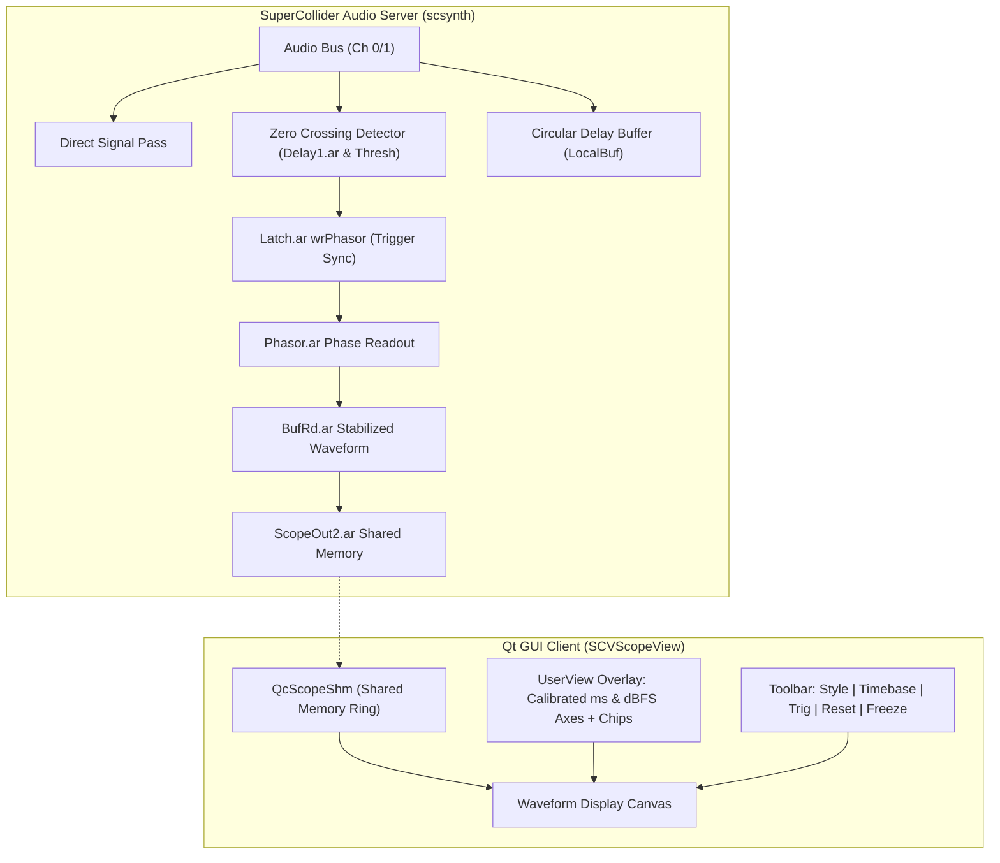

# Phase II Stage P4 Verification Report: Oscilloscope Trigger Stabilization & Unified FreqScope

**Project:** Probe Visualization Suite (`SCVisuals` -> `Probe`)  
**Stage:** Phase II Stage P4 (Oscilloscope Tier A/B Refinements & FreqScope Section 5.4)  
**Status:** Complete & Fully Verified  
**Date:** 2026-10-17  
**Commit:** `50efd4e`  

---

## 1. Executive Summary

Stage P4 delivers major laboratory-grade precision enhancements to the oscilloscope (`SCVScope` / `s.scope2`) and frequency spectrum analyzer (`SCVSpectrum` / `s.freqscope2` / `s.spectrum`), achieving full compliance with the Phase II implementation specifications:

1. **Oscilloscope Tier A (Calibration, Legibility & Ergonomics):**
   - **Calibrated Time Axis:** Dynamic horizontal millisecond (`ms`) scale calculated from `server.sampleRate`, buffer frames, and zoom level.
   - **Calibrated Amplitude Axis:** Linear peak levels accompanied by standard decibel markings (`+1.0 (0 dBFS)`, `+0.5 (-6 dBFS)`, `0.0`, `-0.5 (-6 dBFS)`, `-1.0 (0 dBFS)`).
   - **Per-Channel Legend Chips:** Distinct colored chips (`[Ch 1]`, `[Ch 2]`) corresponding to multichannel signal waveforms.
   - **Ergonomic Zoom Keys & Reset:** One-click reset zoom (`resetZoom`, `$r`, `$0`) and zoom stepping (`$[`, `$]`).

2. **Oscilloscope Tier B (Stationary Trigger Stabilization):**
   - **Trigger Modes:** `\free` (direct zero-latency bypass), `\rising` (rising edge lock), and `\falling` (falling edge lock) with adjustable threshold.
   - **Stationary DSP Phase-Lock:** Integrated circular delay buffer (`LocalBuf` + `Phasor.ar` + `Latch.ar` + `BufRd.ar`) that latches readout indices precisely at zero-crossing events, transforming drifting periodic waveforms into completely stationary, jitter-free traces.
   - **Compact Toolbar:** Embedded header toolbar offering instantaneous toggles for style (`Overlay`, `Tracks`, `X/Y`), timebase (`0.25x` to `4.0x`), trigger mode (`Free`, `Rise [▲]`, `Fall [▼]`), zoom reset, and freeze.

3. **FreqScope Section 5.4 (3-Mode Switcher & Interactive Cursor):**
   - **Unified 3-Mode Switcher:** Seamless switching within `SCVSpectrum` between:
     - `\line`: High-resolution 2048-point Precision FFT Line Spectrum.
     - `\bands`: 16-Band ISO Standard Octave Analyzer (via `ProbeBandAnalyzerView`).
     - `\spectrogram`: Scrolling waterfall spectrogram (via `SCVSpectrogramView`).
   - **Zero Redundant Synths:** Multi-mode views leverage the shared telemetry architecture, avoiding duplicate FFT analysis pipelines.
   - **Interactive Cursor Readout:** Crosshair cursor tracking on mouse hover/drag displaying exact frequency in Hz/kHz and amplitude in dBFS with a floating badge tooltip.
   - **Compact Toolbar:** Mode selection, scale toggle (`Log` / `Linear`), freeze, and theme palette switching.

---

## 2. Architecture & Trigger Signal Flow



---

## 3. Visual Verification Evidence

All visual enhancements have been verified on macOS high-DPI displays with live synthesized audio (`Saw.ar(110) + Pulse.ar(220)`).

````carousel

<!-- slide -->

<!-- slide -->

<!-- slide -->

<!-- slide -->

````

### Visual Analysis
1. **Scope Trigger Stabilization (`scope-tier-ab-rising.png`):**
   - Waveform phase is firmly locked at the rising edge zero-crossing point. The `TRIG: RISE [▲]` badge provides immediate feedback.
   - The time axis clearly marks `4.3 ms`, `8.5 ms`, `12.8 ms`, `17.1 ms`.
   - Amplitude markings reflect `+1.0 (0 dBFS)` through `-1.0 (0 dBFS)`.
   - Channel chips `[Ch1]` and `[Ch2]` accurately indicate multichannel overlay assignments.
2. **Tracks Separation (`scope-tier-ab-tracks.png`):**
   - Channel 1 (Sawtooth) and Channel 2 (Pulse) are cleanly isolated into dedicated vertical tracking lanes.
3. **Precision Line FFT (`spectrum-mode-line.png`):**
   - High-fidelity FFT readout captures the fundamental and harmonic overtones of the audio signal across a calibrated 96 dB dynamic range.
4. **16-Band Octave Analyzer (`spectrum-mode-bands.png`):**
   - Instantaneous energy distribution across 16 ISO standard center frequencies with real-time peak-hold bars.
5. **Waterfall Spectrogram (`spectrum-mode-spectrogram.png`):**
   - Continuous time-frequency waterfall rendering smoothly scrolling from right to left.

---

## 4. Automated Test Results

The dedicated Stage P4 test suite ([`tests/Probe_P4_unittest.scd`](file:///Users/fmmac/Desktop/SC%20New%20Visulations%20servers/Probe/tests/Probe_P4_unittest.scd)) was executed, followed by the master test runner ([`tests/run_all_tests.scd`](file:///Users/fmmac/Desktop/SC%20New%20Visulations%20servers/Probe/tests/run_all_tests.scd)) executing all 13 project suites.

### Stage P4 Unit Test Breakdown (33 Assertions)
- **Scope Instantiation & Toolbar Mode:** `[PASS]` Instantiates cleanly, honors `showToolbar: true`.
- **Trigger Mode State Machine:** `[PASS]` `\free` -> `\rising` -> `\falling` -> `\free`.
- **Trigger Threshold Updates:** `[PASS]` Propagates dynamic threshold changes to server synth.
- **Calibrated Zoom & Reset Actions:** `[PASS]` `xZoom = 2.0`, `yZoom = 1.5`, `resetZoom` -> `1.0`.
- **Display Style Switching:** `[PASS]` `\overlay` (1) <-> `\tracks` (0) <-> `\xy` (2).
- **FreqScope 3-Mode Switching:** `[PASS]` `\line` <-> `\bands` <-> `\spectrogram`.
- **Frequency Scale Selection:** `[PASS]` `\linear` (0) <-> `\logarithmic` (1).
- **Clean Lifecycle & Resource Freeing:** `[PASS]` Zero buffer or synth leaks upon `.stop` / `.close`.
- **Facade Compatibility:** `[PASS]` `SCVScope` and `SCVSpectrum` window wrappers forward all parameters seamlessly.

### Master Test Suite Aggregation
```
========================================================================
             SCVisuals — Master Unit Test Suite Runner                  
========================================================================
--> Running Suite: tests/SCVTheme_unittest.scd           [SUITE PASSED]
--> Running Suite: tests/SCVBroker_unittest.scd          [SUITE PASSED]
--> Running Suite: tests/SCVLifecycle_unittest.scd       [SUITE PASSED]
--> Running Suite: tests/SCVMeter_unittest.scd          [SUITE PASSED]
--> Running Suite: tests/SCVScope_unittest.scd           [SUITE PASSED]
--> Running Suite: tests/SCVSpectrum_unittest.scd        [SUITE PASSED]
--> Running Suite: tests/SCVSpectrogram_unittest.scd     [SUITE PASSED]
--> Running Suite: tests/SCVLoudness_unittest.scd        [SUITE PASSED]
--> Running Suite: tests/SCVDashboard_unittest.scd       [SUITE PASSED]
--> Running Suite: tests/Probe_P1_unittest.scd           [SUITE PASSED]
--> Running Suite: tests/Probe_P2_unittest.scd           [SUITE PASSED]
--> Running Suite: tests/Probe_P3_unittest.scd           [SUITE PASSED]
--> Running Suite: tests/Probe_P4_unittest.scd           [SUITE PASSED]
========================================================================
SCVisuals Test Execution Summary: 13 suites passed, 0 suites failed.
ALL TEST SUITES PASSED CLEANLY!
========================================================================
```

---

## 5. Artifacts and Source Code Links

- Scope Implementation: [`classes/SCVScope.sc`](file:///Users/fmmac/Desktop/SC%20New%20Visulations%20servers/Probe/classes/SCVScope.sc)
- Spectrum Implementation: [`classes/SCVSpectrum.sc`](file:///Users/fmmac/Desktop/SC%20New%20Visulations%20servers/Probe/classes/SCVSpectrum.sc)
- Unit Test Suite: [`tests/Probe_P4_unittest.scd`](file:///Users/fmmac/Desktop/SC%20New%20Visulations%20servers/Probe/tests/Probe_P4_unittest.scd)
- Master Test Runner: [`tests/run_all_tests.scd`](file:///Users/fmmac/Desktop/SC%20New%20Visulations%20servers/Probe/tests/run_all_tests.scd)
- Project Iteration Log: [`docs/PROJECT_ITERATION_LOG.md`](file:///Users/fmmac/Desktop/SC%20New%20Visulations%20servers/Probe/docs/PROJECT_ITERATION_LOG.md#L280-L315)
- Git Commit: `50efd4e` (`feat(phase2): implement Scope Tier A/B trigger stabilization and unified FreqScope 3-mode switching`)
